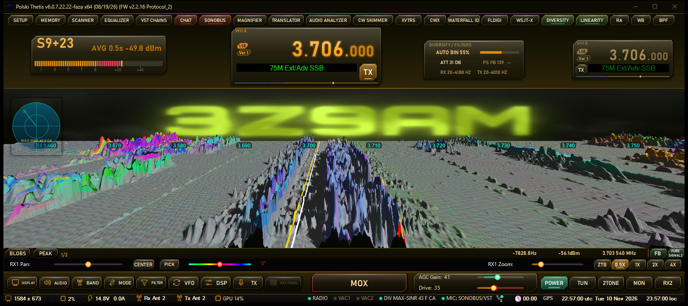
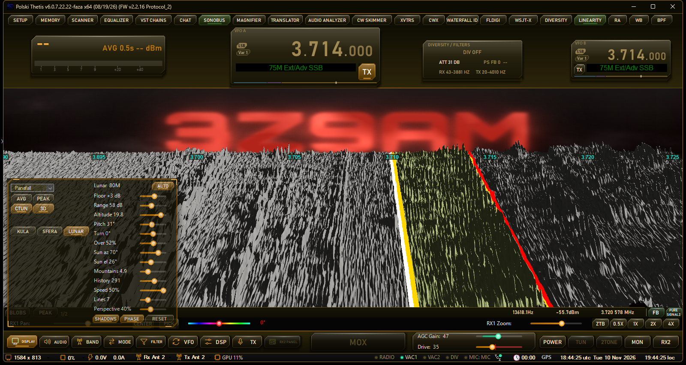
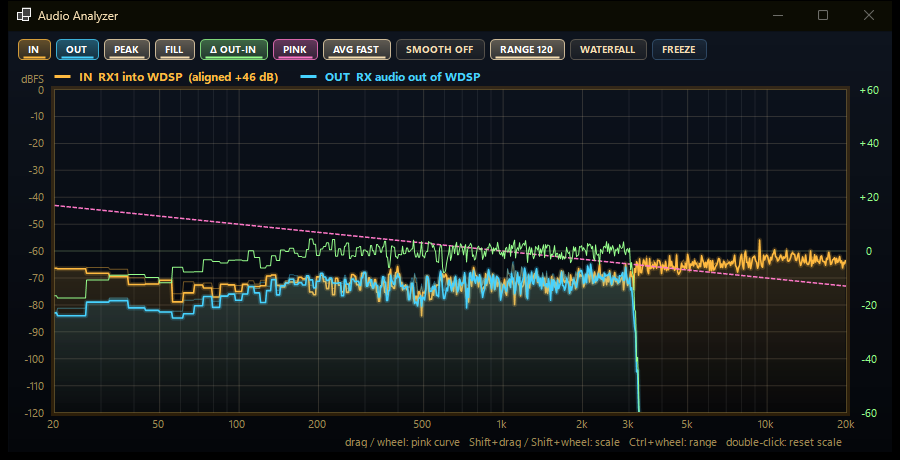
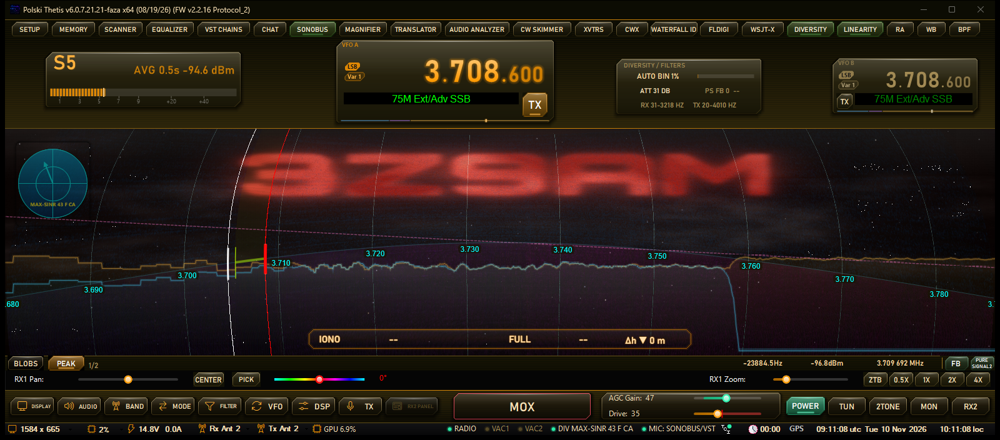
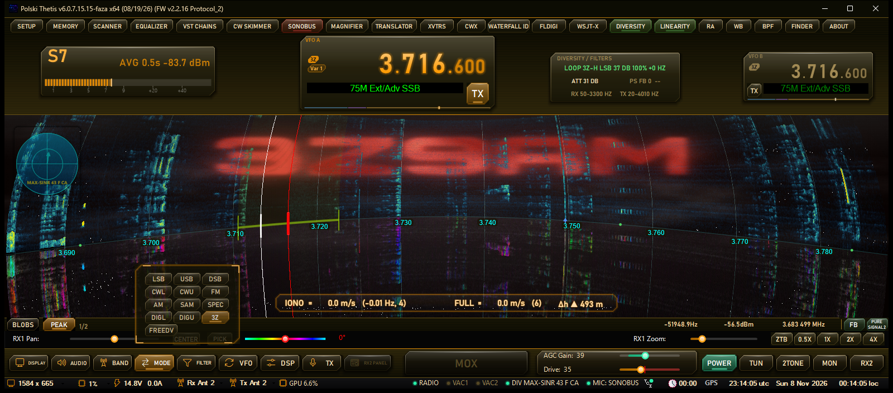
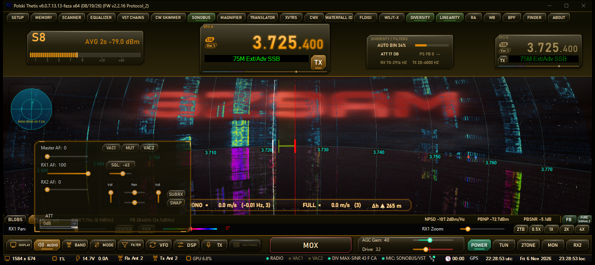

# SDR-VST3 – 3Z9AM edition

A fork of **SDR-VST3** by SQ4KOU (itself based on **Thetis**, the OpenHPSDR console), developed and tested by **Daniel Poznański, 3Z9AM** on an ANAN-7000DLE (Protocol 2).

**Download:** [Releases](../../releases) – take the `.msi` (needs the .NET 10 Desktop Runtime x64; the installer says so if it is missing).
Separate builds: `-hl2` (Hermes Lite 2, branch `hl2`) and `-sunsdr` (SunSDR2, branch `sunsdr`), not tested by me on a radio – feedback welcome.

**Test versions:** since 6.0.7.15 the releases contain installers only – the code in this repository and its tags correspond to 6.0.7.14. Source of a newer version is available on request (Issues) or after the tests end. / *Od 6.0.7.15 wydania zawierają same instalki – kod w repozytorium odpowiada wersji 6.0.7.14; kod nowszej wersji na żądanie (Issues) lub po zakończeniu testów.*

*Zrzuty ekranu z wersji ANAN (ten sam interfejs; elementy diversity – radar, AUTO BIN – w tej wersji nie występują).*

## Zmiany / Changelog
Wersje ANAN (gałąź `main`); `-hl2` / `-sunsdr` dostają te same zmiany bez diversity, czasem z opóźnieniem.

- **6.0.7.24** (11.11.2026, `-hl2` / `-sunsdr`) – 3Z Chat: odbiornik dekoduje **jednocześnie tryb zwykły (Slow) i Fast** – checkbox Fast wybiera już tylko tryb nadawania; przy odebranej wiadomości tryb, np. `(fast, +3 Hz, DT +0.2 s)`. Panorama 3D LUNAR: **CENTER** celuje kamerą między środkiem filtra RX1 a linią zero beat (65 % drogi do linii), więc linia zero beat jest widoczna z boku (USB i LSB).
- **6.0.7.23** (11.11.2026, `-hl2` / `-sunsdr`) – panorama 3D **LUNAR** (nowy przycisk obok KULA / SFERA w szufladzie Display): historia wodospadu jako teren księżyca – horyzont = najnowszy wiersz, sygnały to góry z cieniami od słońca, lot nad terenem płynny, wiersze nadawania jako lawa. Panel w szufladzie: wysokość i pochylenie kamery, obrót, przesunięcie w bok, słońce (azymut / wysokość), góry, historia, perspektywa, prędkość lotu, szerokość linii; poziomy Min/Max dBm osobno dla każdego pasma albo **AUTO** (od szumu panoramy + zakres); **REVERSE** – odwrócony kierunek lotu (najnowsze przy kamerze), kamera podąża w bok za filtrem RX1, **CENTER** – filtr RX1 zawsze na środku. Filtr, VFO i linie TX/CW rysowane na terenie, klik i przeciąganie filtra po powierzchni. Nowa instalacja dostaje ustawienia Lunar 3Z9AM (REVERSE + CENTER + AUTO, cienie).

  

- **6.0.7.22** (10.11.2026, `-hl2` / `-sunsdr`) – nowy kafelek menu **Audio Analyzer** – analizator widma audio tego, co wchodzi do WDSP i co z niego wychodzi (20 Hz–20 kHz, skala log, dBFS). Na odbiorze: **IN** = sygnał RX1 przed WDSP (IQ przeliczone na pasmo audio wg trybu: USB / LSB / obie wstęgi; wyrównany do wyjścia, napis „aligned +xx dB”), **OUT** = audio RX za WDSP i łańcuchem VST (przed głośnością AF – działa też przy słuchaniu przez VAC/SonoBus z AF = 0). Na nadawaniu: IN = audio TX wchodzące do WDSP (po VST / VAC / TCI / mikrofonie), OUT = sygnał TX z WDSP. **Window** – osobne okno z opcjami: PEAK (szczyty), FILL, **Δ OUT-IN** (co robi WDSP – filtr, NR, AGC; własna oś po prawej), **PINK** (krzywa różowego szumu -3 dB/okt., przesuwana myszą/kółkiem), AVG FAST/MED/SLOW, SMOOTH 1/12–1/3 oktawy, RANGE, wodospad audio, FREEZE, odczyt pod kursorem; Shift + przeciąganie/kółko = skala, Ctrl + kółko = zakres, dwuklik = reset; ustawienia zapamiętywane. **Background** – same krzywe delikatnie w tle panoramy RX1 (także nad kulą 3D), wg ustawień z okna.

  

  

- **6.0.7.21** (10.11.2026, `-hl2` / `-sunsdr`) – panorama 3D, widok z wnętrza kuli (SFERA): przełącznik **Gaze follows mouse** w oknie ustawień 3D – widok RX1 płynnie przesuwa się po częstotliwości w stronę myszy (do ok. 2,3 % szerokości; wodospad GPU liczy 3 % zapasu za krawędziami, więc bez pustych pasów; skala, znaczniki i kliknięcia idą za widokiem). Kula 3D: dolna połowa bez danych fazy (lustro) zanika w tło jak odbicie od mokrej podłogi. Tło ze znakiem: Setup > Appearance > General **Moving background** – migoczące gwiazdy (domyślnie) albo płynąca mgła, krycie i prędkość.
- **6.0.7.20** (9.11.2026, `-hl2` / `-sunsdr`) – 3Z Chat: tryb **Fast** (ramka 8,9 s w slotach 12 s, 750 Hz, próg ok. -15,8 dB zamiast -18,9 dB w symulacji; obie stacje muszą mieć ten sam tryb), długie wiadomości dzielone na kolejne sloty (części kończą się znakiem ` +`), kafelek Chat miga na czerwono przy nowej wiadomości, wiadomości odebrane przed pierwszym otwarciem okna czatu nie przepadają, filtr TX czatu 1150–2150 Hz, **powtarzanie wiadomości** (checkbox Repeat: co 2–20 slotów, limit 1–240 min, domyślnie co 4 sloty przez 30 min; kończy się też po zwolnieniu MOX lub nieudanym nadawaniu), tryb Fast domyślnie włączony, domyślny QRG 3,708 MHz.
- **6.0.7.18** (8.11.2026, `-hl2` / `-sunsdr`) – 3Z Chat: różnica zegarów stacji do **±1,5 s** (było ±0,5 s; tak jak w FT8), bez straty czułości w symulacji; przy odebranej wiadomości odchyłka czasu **DT**. Windows często nie koryguje błędu poniżej 1 s – trzeba to sprawdzić (`MaxAllowedPhaseOffset`). Poprawka: w 3Z bez CTUN czat i opisy panoramy były przesunięte o 12 kHz. Bez testu na radiu.
- **6.0.7.17** (8.11.2026, `-hl2` / `-sunsdr`) – czat tekstowy **3Z Chat** (menu Chat) – krótkie wiadomości poniżej szumu: 64 tony MFSK co 5,86 Hz (375 Hz), ramka 17,75 s w slotach 20 s UTC jak FT8 (**zegar PC musi być zgodny z UTC do ok. 0,5 s**, NTP), próg ok. -17 dB SNR w 3 kHz na jednej antenie (symulacja). Stały nasłuch wybranego QRG wprost z IQ – można pracować gdzie indziej, byle QRG mieścił się w sample rate; moc w %, filtr TX dobrany do sygnału, MIC nie wbija ALC; maks. 38 znaków z własnym znakiem, wielkie litery bez polskich znaków, zawsze USB. Doszła też cyfrowa fonia **3Z** z wersji ANAN 6.0.7.16 (na jednej antenie).

  

- **6.0.7.14** (6.11.2026)
  - Modern S-metr: **prawy klik = uśrednianie odczytu** (wył. / 0,5 / 1 / 2 / 4 s, zapamiętywane), cyfry i pasek nie skaczą; wybrany czas na napisie (np. `AVG 1s`). Lewy klik dalej MAX/AVG.
  - Szuflada Audio: lista **ATT** i pole **S-ATT** (tłumik krokowy 0–31 dB co 1 dB) obok siebie – S-ATT pojawia się po zaznaczeniu Setup > General > Hardware Config > Step Atten „Enable RX1”; usunięty pasek wystający spod listy ATT.
  - Setup: podświetlenie w drzewie kategorii pokazuje stronę faktycznie otwartą (także po kliknięciu kategorii i rozwinięciu gałęzi); ramka „Spectrum Grid” na stronach Display RX1/RX2 nazywa się „Spectrum Grid / Waterfall 3D” (tam ustawia się też poziomy 3D).

  

- **6.0.7.13** (6.11.2026) – szuflada Display: przyciski **KULA** (kula wodospadu 3D oglądana z zewnątrz) i **SFERA** (widok z wnętrza kuli – planetarium); każdy włącza 3D, drugie kliknięcie wraca do płaskiego 3D; płaskie 3D i kula zachowują osobne ustawienia.
- **6.0.7.12** (6.11.2026)
  - **PICK – wybór stacji po fazie RX2-RX1** (diversity, ANAN z dwoma odbiornikami) – przycisk PICK i kolorowy suwak fazy -180..180° obok RX1 Pan. Słychać stację, której faza między antenami zgadza się z suwakiem; silne sygnały o innej fazie są ściszane o 15 dB, a każdy z nich jest śledzony, gdy jego faza wędruje. Suwak sam podąża za wybraną stacją (chwycenie suwaka = nowa faza); kolor toru = kolory widoków fazy. Napis przy suwaku pokazuje stałość fazy w filtrze: „steady 0.34” = PICK działa, „random 0.19 – off” = faza losowa (tęcza w widokach fazy), PICK usuwa się wtedy z drogi, aż faza się ustabilizuje. Wymaga Diversity z RX1 + RX2 i otwartego (może być zminimalizowane) okna Diversity, najlepiej z „fine”. Najwięcej daje, gdy obie anteny słyszą stacje podobnie, a faza przeszkadzającej stacji różni się o ~90° lub więcej (w testach do ok. +8 dB względem samego miksu); przy fazie losowej (często 80 m) nie pomaga – wtedy lepszy jest filtr.
  - AGC: tryb zapisany przez starszą wersję, którego już nie ma (np. „Transparent”), ustawia MED zamiast błędu przy starcie.
  - `-hl2` / `-sunsdr` 6.0.7.12 (6.11.2026): zmiany z 6.0.7.11 (Tłumacz RX, nazwy urządzeń VAC z polskimi znakami) i poprawka AGC z 6.0.7.12; bez PICK (wymaga diversity).
- **6.0.7.11** (5.11.2026)
  - **Tłumacz RX** – kafelek menu „Translator”: Off / Transcribe (napisy w języku mówiącego) / Translate to English. Mowa z RX1 rozpoznawana lokalnie przez Whisper (karta graficzna przez Vulkan, bez karty – procesor), napisy na szklanej płytce nad IONO, dwie ostatnie linie z kodem języka (np. `RU › …`), znikają po 20 s ciszy. Model (1,1 GB) pobiera się przy pierwszym włączeniu – postęp na płytce; potem „warming up” (pierwsze uruchomienie na GPU ok. 10 s). Napis pojawia się 1–3 s po przerwie w mowie (przy ciągłej mowie co 8 s). Przy słabym sygnale tekst bywa zmyślony.
  - VAC: nazwy urządzeń audio z polskimi (i innymi) znakami wyświetlane poprawnie; zapisane wcześniej ustawienia VAC i profili TX dopasowywane do nowych nazw.
- **6.0.7.10** (4.11.2026) – okno Setup (Modern Look): ucinane napisy, pola i przyciski poszerzane w wolne miejsce, ramki z ukrytymi opcjami zwijane, ciemne paski przewijania.
- **6.0.7.9** (4.11.2026) – „Pure VST TX” (Setup > Audio > TX Advanced – bez obróbki WDSP, 0 dB z VST = pełna moc), mierniki TX AF / TX PEP w panelu między VFO.
- **6.0.7.8** (3.11.2026) – ogranicznik szczytów RX, AGC pasmowe (Multiband AGC), AGC Pause Hold, kula 3D bez niewidocznego śladu 2D (mniej pracy procesora).
- **6.0.7.7** (1.11.2026) – płytka HUD dryfu jonosfery (IONO / FULL / Δh), kąt przyjścia fali z dwóch anten diversity z auto kalibracją ze skimmera, szuflady bez animacji, okno Setup bez białych prostokątów.
- **6.0.7.6** (1.11.2026) – strzałki dryfu jonosfery i „Doppler” na kuli 3D, lupa „Magnifier”, diversity WF dphase, kafelki menu świecą na zielono (CW Skimmer / VST Chains / Linearity).
- **6.0.7.5** (1.11.2026) – w czasie TX pierwszy wiersz panelu DIVERSITY / FILTERS pokazuje poziom m.cz. (szczyt mikrofonu za łańcuchem VST TX, -30..+3 dBFS, powyżej 0 dB czerwony).
- **6.0.7.4** (31.10.2026) – VST3: dodatkowe szyny audio wtyczek (sidechain, np. Waves) dostają wyzerowane bufory – naprawia wtyczki, które grały ciszą.
- **6.0.7.3** (31.10.2026) – MUT w 4 stanach (klik): zielony = cisza w głośniku, fioletowy = cisza na VAC1, czerwony = cisza wszędzie.
- **6.0.7.2** (31.10.2026) – analizator TX bierze zakres częstotliwości z RX1.
- **6.0.7.1** (31.10.2026) – Crystal filter, Warmth i tryb AGC „Tube” (Setup > DSP), cienie paneli.
- **6.0.7.6-sunsdr** (1.11.2026, tylko `-sunsdr`) – filtr TX przy decymacji 192k → 39k z pasmem 18 kHz zamiast 4 kHz – SSB TX nie jest już obcięte do ok. 4,7 kHz. Nie testowane na radiu.
- **6.0.7.0** (31.10.2026) – jeden numer wersji dla wszystkich wariantów (ANAN / HL2 / SunSDR); **Analog tone** (Setup > DSP > Spatial / Tone) – łagodny spadek wysokich tonów jak w torze m.cz. odbiornika analogowego, punkt spadku może iść za górną krawędzią filtra RX; nowy układ: wklęsły górny pasek, panel nad panoramą przesuwany i przezroczysty jak VFO, głębia szkła (cienie, panele unoszą się pod myszą), górne menu jako kafelki HUD, kółko myszy nad otwartą szufladą nie stroi VFO.
- **6.0.6.x** (30.10.2026)
  - Sprawdzanie nowej wersji przy starcie – napis „Update available” na pasku stanu tylko, gdy na GitHubie jest nowsza wersja tego wariantu (klik = strona wydania).
  - **VST TX – dwie równoległe ścieżki A / B** (przycisk „To B”, poziomy „A dB” / „B dB”, opóźnienia wtyczek wyrównywane), rack w dwóch kolumnach; **import sesji Waves** SuperRack (.sprk) / MultiRack (.mrdb) – przycisk Import w oknie łańcucha; okno VST Chains w stylu Modern Look.
  - SunSDR2 PRO: sample rate 312,5 / 156,25 / 78,125 kHz (Setup, zmiana restartuje radio; DX tylko 312,5).
  - FM: przycisk MIC i TXVST / RXVST / VSTTEST widoczne także w FM; SonoBus: adaptacyjny bufor głosu, łańcuch RX / SonoBus nie przebudowuje się przy zmianie bloku (wcześniej SonoBus wypadał z grupy); kod aktywacji z poziomami; okno startowe z obrazkiem znaku; instalator .exe nie zatrzymuje się, gdy nowszy .NET 10 jest już zainstalowany.
- **6.0.3.0 – 6.0.5.0** (28–29.10.2026) – ręczna korekta S-metra ±15 dB (Setup > General > Calibration); kontenery Meters / Gadgets nad panelami nowego układu; okno **SonoBus** – jedna instancja poza łańcuchami VST (RX → grupa, grupa → mikrofon TX); MUT w szufladzie Audio; instalator zawsze zastępuje zainstalowaną wersję; poprawny zapis stanu konsoli w nowym układzie; poprawka zawieszenia po POWER przy „Adjust Min to Noise Floor”.

## What is new in this fork
- **New HUD-style interface** – full-window panadapter, top bar with VFOs and S-meter, dock with drawers for the original panels, movable panels (Shift + drag), accent colour.
- **3D panadapter** on the GPU – depth history, floor marks, peak skyline, "waterfall sphere" and inside (planetarium) view.
- **Diversity per section** (ANAN with two receivers) – max-SINR / MRC / co-phase / null per frequency section, "clean" AUTO, phase views (radar arrow, phase waterfall, 3D phase colours).
- **WDSP 2.30** – WDSP 2.10 merged with PureSignal from 2.00, NR3/NR4/NR5, soft filter edges (high-tone and carrier side), BIN2 stereo/spatial audio, AGC attack and impulse recovery.
- **3D LUNAR** (waterfall history as a lunar landscape), **3Z** digital voice (Opus over OFDM in 3 kHz) and **3Z Chat** (MFSK text below the noise, FT8-like slots), **RX translator** (Whisper), **Audio Analyzer**, Multiband AGC, RX peak limiter.
- **GPU waterfall** with exact FFT, animated / callsign background, built-in CW Skimmer, SonoBus window (remote audio via VST), S-meter correction.

## Requirements
- Windows 10/11 x64, **CPU with AVX2**.
- The program asks for an **activation code** (menu "Activation", or after pressing POWER) – contact 3Z9AM.
  The code is there so I stay in touch with every tester: when you send the request code, please add your **radio** (model, firmware), **antennas** and **location** (QTH / locator). This helps refine the program for different radios, antennas and receiving conditions.
- Installs as its own program next to Thetis / SDR-VST3; the installer replaces any installed SDR-VST3 version.

## Source and licence
GPL v2 or later. Releases up to 6.0.7.14 have their source under the tag of the same name (e.g. `v6.0.6.0`); for later test versions the source is available on request (Issues). This public repository contains release snapshots only.
Original authors and credits are kept below and in the file headers (FlexRadio Systems, Doug Wigley W5WC, Richard Samphire MW0LGE, Warren Pratt NR0V, SQ4KOU, ChasingCoffee and others).

---

*PL:* Fork SDR-VST3 (SQ4KOU / Thetis) rozwijany przez 3Z9AM: nowy interfejs HUD, panorama 3D na GPU, diversity sekcyjne, WDSP 2.30. Instalki w zakładce Releases, wymagany procesor z AVX2 i kod aktywacji. Kod jest po to, żebym miał kontakt z testerami: przysyłając kod prośby, podaj radio (model, firmware), używane anteny i lokalizację (QTH / lokator) – to pozwala dopracować program.

---

What is SDR-VST3?
SDR-VST3 is a fork of Thetis (the OpenHPSDR software-defined radio console application) that adds built-in VST3 audio plugin support to ham radio operations. It allows operators to insert professional audio plugins (EQs, compressors, gates, limiters, noise reduction, etc.) into both the RX (receive) and TX (transmit) signal chains — similar to how a DAW works, but for live radio signal processing.
Originally called "Thetis Plus", it was rebranded to SDR-VST3 in v4.1 (at the suggestion of Thetis maintainer Richie MW0LGE) to run as a fully independent, side-by-side installation alongside standard Thetis.

Key changes in this release:
- New name, new look — The fork is now called "SDR-VST3" with updated splash screen, app icon, and installer artwork.
- 
- It now Installs side-by-side — It installs as its own separate program, so it won't overwrite or conflict with an existing Thetis installation. You can run both. (Understand there's No guarantees here that i didn't miss something but in my own testing everything works separately as it should)
-  
- Separate settings — It keeps its own data folder (SDR-VST3-x64), so your VST chains and settings don't get mixed up with the original Thetis.
- 
- Fresh version numbering — Versioning now starts clean at v4.1, so it's easy to tell releases apart.
Install the MSI like any other Windows program — the installer will walk you through it.
-
-Since this is based on Thetis you can import your current database from your Thetis v2.10.3.15 if you like after the restart it will complain because of version conflicts with the new version system its ok allow it to update and you'll be all set.
-
-All future releases will install independent of Thetis so as to avoid conflicts.  

This version of thetis has a built in vst plugin system it can only use vst3 plugins it can not use .vst or .vst2 plugins
the plugin system is enabled by default, no shortcut flag is needed
it is only for 64bit systems there is no x86 32 bit version.

Special Thanks to chasingcoffee his hard work is what made this vst version possible  
Forked from his original at his github page 
https://github.com/ChasingCoffee/Thetis/tree/vst-support

Credits — RADE / FreeDV digital voice
The RADE (Radio AutoEncoder) digital-voice modem and FreeDV integration was ported from Christos Nikolaou's (SV1EIA) Thetis-RADE fork:
https://github.com/sv1eia/Thetis-RADE

Special thanks to:
- Christos Nikolaou (SV1EIA) <sv1eia@gmail.com> — the Thetis-RADE fork and C port of the RADE modem this feature is built on
- Peter B Marks — radae_nopy, the reference implementation the RADE port was made from
- David Rowe & Jean-Marc Valin — original authors of RADE (Radio AutoEncoder)
- The FreeDV project (David Rowe / drowe67) — FreeDV-GUI's rade_text reliable-text codec and the codec2 library used for EOO callsign frames

The RADE DSP dependencies vendored under Project Files/lib/ keep their own licences (BSD-2-Clause / BSD-3-Clause / MIT / LGPL-2.1); see the commit_pin.txt and LICENSE / NOTICE files in each lib/<vendor> directory.

Changelog
VST2 Support Removed
Removed VST2 plugin support entirely to avoid potential licensing and legal issues. It now exclusively supports VST3 plugins.

Scanner Improvements
- Added detailed progress output during plugin scanning, including per-plugin timing and probe status (resolved via moduleinfo.json vs probing out-of-process)
- Added WAVESHELL support — the scanner can now probe WAVESHell VST3 bundles without freezing, handling their slow plugin enumeration and problematic cleanup routines

RX/TX VST Bypass
Added front panel buttons to bypass RX VST and TX VST processing independently right clicking them will bring you directly into the chain host window

Release 4
 v2.10.3.15-4
 
In this version of Thetis plus with built in vst host we have added meter gadgets that can load a list of your active plugins for easy access from the front console just click the plugin and the editor instantly opens right from your console you can setup a container for rx and one for tx or load them both in one container however you choose.

Also included in this version are the opensource linux studio plugins to give you something to start with right out of the box there are much better paid plugins available but these are free and can get you going right away they include various eqs compressors gates dynamics limiters etc.. a full package of plugins

Version 4.1 Rebrand to avoid confusion
 V4.1

After a brief discussion with Richie [MW0LGE] who maintains the last version of Thetis v2.10.3.15 which this software fork is based on
He suggested a rebrand to keep versions from becoming confusing among other issues.
He also suggested it should be its own install databases etc. as to be able to run side by side with Thetis and not overwrite it.

Key changes in this release:

New name, new look — The fork is now called "SDR-VST3" with updated splash screen, app icon, and installer artwork.
It now Installs side-by-side — It installs as its own separate program, so it won't overwrite or conflict with an existing Thetis installation. You can run both. (Understand there's No guarantees here that i didn't miss something but in my own testing everything works separately as it should)
Separate settings — It keeps its own data folder (SDR-VST3-x64), so your VST chains and settings don't get mixed up with the original Thetis.
Fresh version numbering — Versioning now starts clean at v4.1, so it's easy to tell releases apart.
Install the MSI like any other Windows program — the installer will walk you through it.

 V4.2 all new user interface

 
Big shoutout to Ben Shapiro aka Chasing coffee for the new rack user interface and the mini rack user interface for the meter gadgets

VST Rack Gadgets

Added new TX and RX VST Plugin gadgets to the meter system. Instead of the old plain text plugin list, each gadget now shows the interactive rack: one row per plugin with artwork, a status light, and buttons to enable/disable, bypass/unbypass, open the editor, remove, or reorder plugins with a drag. A chain that's bypassed dims the whole rack.
Gadgets are added from Setup, and persist across restarts, and can be floated into their own window and placed anywhere (including another monitor) using the float button that appears when you hover over the top right corner.
Bypass & Enable sync

Enabling or bypassing a plugin (or the whole chain) now stays in sync everywhere at once: the rack gadgets, the chain manager, and the TX/RX VST bypass buttons on the main screen all update together, no matter which one you use.
Cleaner help

Hovering over rack controls now shows a short tooltip explaining what each button does (e.g. "Bypass plugin",

V4.3 updated to wdsp 2.00
 
What's new in this build

Tonight we upgraded the engine that powers SDR-VST3 — the digital signal processing core that does the heavy lifting for receiving, filtering, and noise reduction.

This newer engine (WDSP 2.00) modernizes the foundation underneath features you already use, including noise reduction, the audio equalizer/compressor, the spectrum display, and PureSignal's automatic transmit-signal correction.

We also:

Removed the need for the -vst flag to start in vst mode vst mode is the default now so no need to modify the shortcut any longer
Fixed a startup crash that could affect people with existing saved settings — your old profiles now load cleanly.
Fixed the Phase Rotator panel on the CFC tab, which was slightly too small and was clipping its new controls.
Confirmed SDR-VST3 is fully self-contained. It keeps its own settings folder, saved data, and even its own recording and firewall entries, so you can install and run it side-by-side with a normal Thetis installation without the two mixing up or overwriting each other's settings.

No need to start over — if you already have SDR-VST3 installed, your existing profiles and tuned-up radio performance carry straight over.
Thanks to Yurij-eu2av for the WDSP 2.00 integration work, and to ChasingCoffee for the original VST3 host support, which this project builds on.
It is not 100% Required to rebuild your wisdom file but if you know how you should its as simple as deleting it and when you start up again it will build a new one.
It is usually located at C:\Users"your username"\AppData\Roaming\OpenHPSDR\SDR-VST3-x64

V4.4 VST Routing for TCI and VAC Audio Visual changes
  
VST Routing for TCI and VAC Audio
You can now decide whether audio going to/from your virtual sound cards (VAC) and TCI software passes through Thetis's VST effects (EQ, compressors, etc.) or stays "raw" and untouched.

On the VAC audio options tab — Apply RX VST and Apply TX VST checkboxes for each VAC send your receive or transmit audio through the VST chains instead of the raw audio.
On the TCI network tab — Apply RX VST and Apply TX VST checkboxes do the same for audio going to/from TCI-connected software.
Each one is a simple checkbox, defaulting to off, so your sound stays exactly as it is today until you turn it on. Use them when you want software to hear your processed audio rather than the dry input.
Visual changes

The on-screen grid lines
Fresh installs of SDR-VST3 now start with the "Display Major Grid" and "Display Minor Grid" lines turned off by default, so the screen looks cleaner out of the box.
existing users settings are left completely alone. If you already had the grids on, they stay on. Only brand-new installs see them off.
You can still turn the grids on/off any time in the Setup → Appearance → RX Display screen.

New skin
New installs use the new SDRVST3 Skin automatically.
If you are upgrading from an older version you will get a one time popup after install of the new version.

V4.5 Transmit profile organizer and 3d panadapter

What's new in this version:

3D Spectrum Display — Your panadapter now has a retro-future 3D waterfall view with stacked perspective traces You can adjust perspective, depth, ridge height, speed, and atmospheric haze to taste.
Waterfall Color Sync option — The 3D display automatically uses your waterfall's color scheme, so everything looks cohesive.
3D Spectrum can also use color of your choosing or use the standard Thetis gradient.
WDSP 2.00 Engine — Upgraded the underlying DSP engine for better performance.
TX Profile Reordering — Cleaner transmit profile management.
Please Note:
The 3d spectrum display is still a work in progress if your experience any DirectX related crashes let me know and if possible provide a screenshot of the error.

V4.6 .NET 10 NEW GRAPHICS ENGINES

What's New in this version

Modernized Foundation (Still a work in progress)

The application has been upgraded to the latest .NET 10 platform — bringing faster startup, better performance, improved security, and a future-proof base for continued development.

The entire graphics system has been migrated from an outdated, no-longer-maintained DirectX library (SlimDX) to the modern, actively developed Vortice framework. All display drawing — panadapter, waterfall, meters, and scopes — now runs through this updated pipeline.

A built-in safety net automatically falls back from GPU-accelerated to CPU-based drawing if a graphics driver problem is detected, so the display keeps working on problematic systems.

Internal settings storage has been moved to a cleaner, more reliable modern format.

Numerous low-level memory-safety improvements make crashes caused by the old code far less likely.

-Redesigned 3D Panadapter
Look and accuracy

The 3D "waterfall history" display now uses proper perspective, ridges shrink and fade into the distance as they move back in time, giving a much stronger sense of depth.

The live trace at the front is drawn to exactly the same scale as the 3D surface behind it, so signals no longer appear twice or "jump up" between the trace and the history.

Hills and peaks are shaded by steepness — sharp signals catch the light, flat noise stays subdued — making the terrain easier to read at a glance.
New control

Floor Lift: raises the noise floor up into view so weak signals sitting just above the noise become visible instead of being buried flat against the bottom. Defaults to 0.90.
Colors

Waterfall Sync now reliably overrides every color option (colormaps, gradients, line colors), so the 3D surface always matches your waterfall palette when enabled.
Performance

-Faster, smoother display thanks to your graphics card
Parts of the spectrum display that were previously drawn piece-by-piece by your computer's main processor are now rendered by the graphics card (GPU) in one go.
This is an optional experiment — tick the "GPU mesh (exp.)" box in Setup → Display to try it. Everything looks the same as before; it's just lighter on your PC.

Waterfall: now scrolls via the graphics card instead of being shuffled around in memory.

Spectrum fill: the shaded area under the signal trace is now drawn as a single graphics-card operation instead of hundreds of individual pencil strokes.

3D history surface: view is also GPU-accelerated when in experimental mode.

-Neon glow for the signal trace
The live spectrum trace can now have a soft neon-style glow around it. Turn it on under the Appearance/RX Display tab the strength of the blur is adjustable with the data line slider.
It's rendered efficiently on the graphics card, and switches itself off automatically on machines where it would be too slow.

Safety Net
If the graphics path hits any problem — driver hiccups, window resizing, unsupported hardware — the display instantly falls back to the original drawing method.
You should never see a stuck or missing display; worst case, it simply behaves exactly like it did before this update.

v4.7 Latest GPU compute shaders dual zoom controls

What's New — v4.7.0

Independent RX1/RX2 pan and zoom controls — separate pan sliders, zoom sliders, center buttons, zoom-to-band presets, and recenter button for each receiver
-Automatic update checker offering download of new version if available

GPU Compute Shaders Waterfall color conversion moved to GPU compute shader — dBm-to-BGRA lookup runs entirely on the graphics card via HLSL, eliminating per-row CPU color math experimental for now enable gpu dhsders under Display/General DirectX setting best performance will be seen with both this and mesh enabled

Spectrum normalization moved to GPU compute shader — peak-height calculation for panadapter fill runs on the GPU instead of the CPU column loop

Both pipelines have full CPU fallback — if GPU compute fails, the existing CPU paths take over automatically

Pipeline uses Texture2D staging with CopySubresourceRegion for reliable GPU↔CPU data transfer (works on AMD and NVIDIA)

LUT is uploaded once per color-scheme/threshold change, not per frame
GPU Fallback Architecture

Graceful HW → WARP → CPU rendering chain on device loss or driver errors

Runtime GPU diagnostic log toggle (Options → options3→ Diagnostics → "Log GPU mesh events")

Error dialog capture logging — DX init errors, startup exceptions, and dialog text all written to ErrorLog.txt with version, render path, and stack trace

-Crash Safety Net
Unhandled exception handler catches and logs crashes with full stack trace to ErrorLog.txt before exit
Display Improvements

Waterfall gradient LUT upgraded from 101 to 1024 steps — eliminates color banding on Custom schemes

CI release pipeline

  

See LICENSE and LICENSE-DUAL-LICENSING for licensing details.
